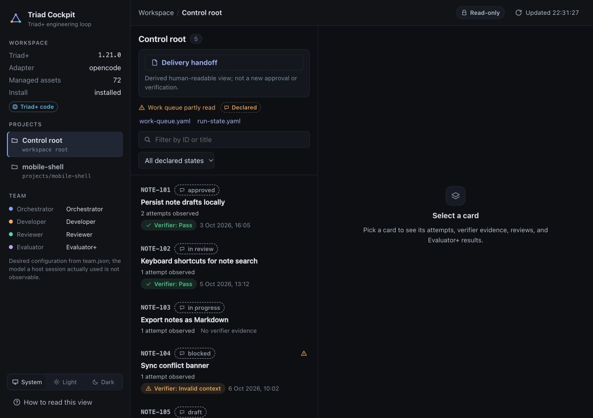
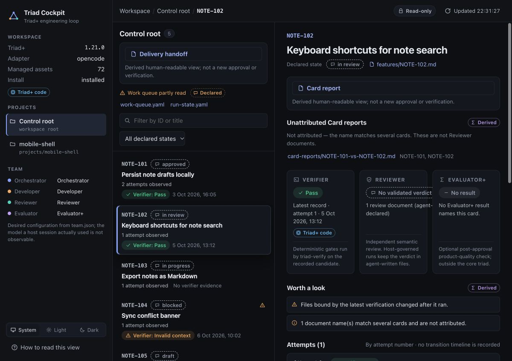
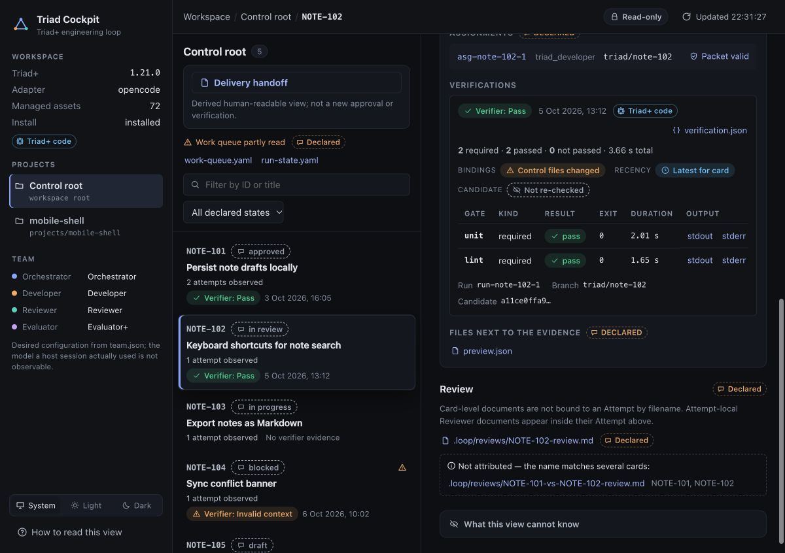
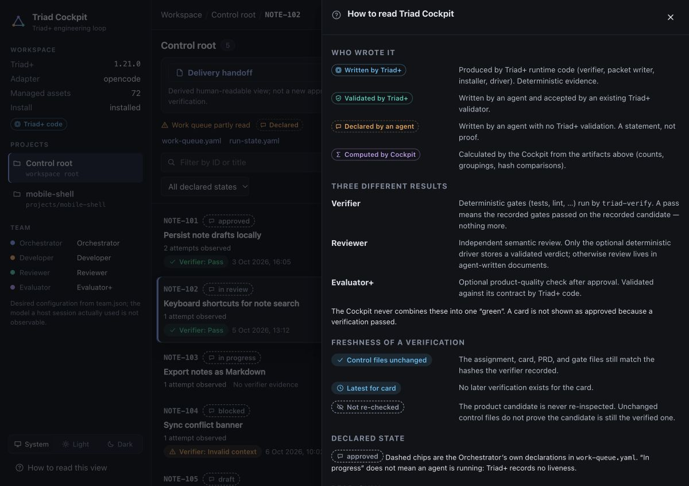

# OpenCode: from a Control Workspace to your first reviewed result

This walkthrough connects setup, a first OpenCode-driven Triad+ loop, its
recorded evidence, the optional human-readable reports, and the read-only
Cockpit. It is a procedure, not a promise that a full loop finishes within a
fixed time.

## Before you start

- Node.js 20 or newer and npm.
- OpenCode installed and configured on this machine, with a model available to
  the host. OpenCode's provider login and model setup are host prerequisites;
  Triad+ does not create credentials or prove which model a session used.
- A local Git product repository and a clear goal small enough to review.
- Permission to create a separate Control Workspace and a declared worktree.

Keep the Control Workspace outside the product repository. It stores the PRD,
work queue, assignments, verifier evidence, reports, and configuration; the
product repository remains the source of product code. A local mapping is not
a clone or a push.

## 1. Create and map the Control Workspace

Start from a new directory that is not inside the product repository:

```bash
mkdir -p "$HOME/projects/sample-control"
cd "$HOME/projects/sample-control"
npx triad-plus
```

In the wizard, choose **New workspace**, keep this separate directory as the
Control Workspace, map the existing local product repository, declare its base
and project branches plus worktree, and select **OpenCode**. The concise
confirmation can be expanded with `details`; exact-path review is required
when a user-level entry is selected before confirming `install`. The wizard
does not create the product worktree, PRD, quality gates, or initial
product-repository commit. It does not log in to OpenCode or write global host
configuration unless an optional entry is selected and approved.

Check the installed version and host/installation diagnostics from the Control
Workspace:

```bash
npx triad-plus version --control .
npx triad-plus doctor --host opencode --control .
```

The setup preview is an installation plan; it does not inspect project
readiness or probe host availability. `doctor` separately diagnoses the
adapter, managed project assets, host executable, and available host/verifier
configuration; it does not establish project readiness or run quality gates.
A successful installation is not the same as a ready project. Check the
required project inputs separately before starting the loop.

## 2. Write the goal and deterministic quality gates

Create `PRD.md` at the Control Workspace root. State the desired outcome and
observable acceptance criteria; keep product requirements in the PRD rather
than embedding them in setup commands. Add `.loop/quality-gates.yaml` with
commands appropriate to the mapped product repository. For example, a Node
project might declare its real test script as a required gate:

```yaml
gates:
  - id: tests
    command: npm test
    required: true
```

Use the gate format and executor supported by the installed Triad+ version;
the example command is valid only when that product repository actually has
an `npm test` script. Commit the product baseline and create the worktree
declared in the project mapping. The setup wizard does none of those tasks.
The wizard does not create the PRD, gate commands, commits, or worktree. Use
the preview to resolve structural setup gaps and `doctor` for host or
installation issues. `triad-verify` later runs the declared gates for a
recorded Attempt.

## 3. Start the OpenCode loop

Open OpenCode with the Control Workspace as its working directory:

```bash
opencode
```

In the interactive session, start the installed command with the root PRD:

```text
/triad ./PRD.md
```

The Orchestrator selects a Card and directs the normal
Developer → verification → Reviewer path. OpenCode is the host that runs the
interactive workflow; `triad-verify` records environment-derived gate results.
The Cockpit is not part of execution and will not start agents. A persisted
`in_progress` declaration is not evidence that an agent is currently alive.

## 4. Follow the evidence, not just status words

The work queue is `.loop/work-queue.yaml`. Assignments and immutable packets
are under `.loop/runtime/assignments/`; attempt evidence is recorded below
`.loop/evidence/<card-id>/attempt-NNN/`. A passing verifier result is bound to
the candidate fingerprint and declared gates at the time it ran. It does not
re-run itself when the candidate later changes. Read it alongside the diff and
Reviewer record; a status written in YAML or prose is a declaration, not a
validated result. See [Verification and evidence](../verification.md) for the
provenance contract.

Triad+ does not create human-readable reports merely because a renderer is
installed. After a Card is terminal, the Orchestrator must explicitly invoke
the [report renderer](../human-readable-reports.md) with context derived from
the canonical Card, verification, and review records. That produces
`card-reports/<card-id>.md`; the final project handoff is materialized
separately as `handoff.md` when the delivery context is ready. A missing file
is simply unavailable—it is not an approval or a delivery failure.

## 5. Read the project and Card in Cockpit

After the workspace has project and Card data, run this in a terminal at the
Control Workspace root:

```bash
npx triad-plus cockpit
```

The current Control Workspace is validated automatically; pass
`--control <path>` to select a different one explicitly. A local interactive
desktop opens the one-time loopback link when safe, and the URL is always
printed as a fallback. Use `--no-open` to suppress automatic opening. The
server is local and read-only; `Ctrl+C` stops it. It reads persisted
artifacts and does not run a gate, start an agent, or materialize a report.

On the project view, **Delivery handoff** opens the existing `handoff.md` when
that file is available. Select a Card to see **Card report** separately from
the Verifier, Reviewer, and Evaluator+ signals. These signals have distinct
provenance: a declared Card state or Markdown statement is not elevated to a
verdict by being visible in Cockpit. Evaluator+ is optional after approval; it
is not a fourth Triad role or a repair controller. The viewer renders Markdown
as inert text, does not fetch links or images, and keeps wide tables and code
inside their own scroll areas on narrow viewports.



*Real Triad+ UI capture; synthetic demo workspace data; not proof of a real
agent run.*



*Real Triad+ UI capture; synthetic demo workspace data; not proof of a real
agent run.*

The attempt detail keeps deterministic verifier evidence distinct from review
documents declared by an agent; the displayed candidate is explicitly not
re-checked by Cockpit:



*Real Triad+ UI capture; synthetic demo workspace data; not proof of a real
agent run.*

The built-in reading guide explains evidence provenance and the limits of each
signal:



*Real Triad+ UI capture; synthetic demo workspace data; not proof of a real
agent run.*

## When something is absent or blocked

- Use the setup preview for structural input/path gaps and `doctor` for host
  and installation diagnostics; neither creates missing inputs or runs gates.
- If no Card report or `handoff.md` exists, first check whether the relevant
  Card is terminal or whether the Orchestrator has invoked the renderer. The
  Cockpit will show the document as unavailable rather than generating it.
- If a gate fails or evidence is stale, use the recorded failure and current
  diff to decide the next step. Do not call an agent claim a passing gate.
- Steps that require an actual OpenCode model session are **not** demonstrated
  by these screenshots or by the Cockpit package smoke. Run the interactive
  `/triad` command in a configured OpenCode session to exercise that host path;
  do not infer it from the presence of adapter files.

For exact report-context fields, see [Human-readable reports](../human-readable-reports.md).
